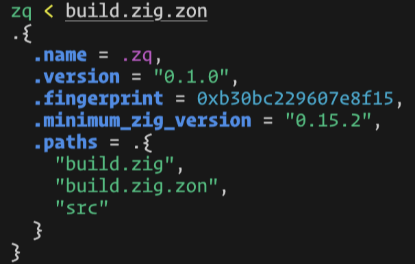

# zq

A lightweight command-line ZON processor. Like [jq](https://jqlang.github.io/jq/), but for Zig Object Notation.



## Features

- Pretty-prints ZON with syntax highlighting
- Extracts values using jq-like filter expressions
- Supports multi-entry ZON files (or cat multiple files)
- Automatic TTY detection for colors

## Installation

Requires [Zig](https://ziglang.org/) 0.15.2 or later.

```bash
git clone https://github.com/bmaland-tv2/zq
cd zq
zig build --release=fast
# Binary is at ./zig-out/bin/zq
```

## Usage

```bash
zq [OPTIONS] [FILTER] < input.zon
```

### Examples

Pretty-print a ZON file:
```bash
cat build.zig.zon | zq
```

Pretty-print multiple ZON files:
```bash
cat *.zon | zq
```

Extract a field:
```bash
zq .name < build.zig.zon
```

Extract nested fields:
```bash
zq .dependencies.zq.path < build.zig.zon
```

Access array elements:
```bash
echo '.{"a","b","c"}' | zq '.[1]'
```

Combine field and index access:
```bash
zq '.items.[0].name' < data.zon
```

Use raw output for scripting:
```bash
VERSION=$(zq -r .version < build.zig.zon)
```

### Filter Syntax

| Filter | Description |
|--------|-------------|
| `.` | Output entire value (default) |
| `.field` | Extract field from struct |
| `.a.b.c` | Extract nested fields |
| `.[n]` | Extract array element by index |
| `.[-n]` | Negative index (from end) |

### Options

```
-C, --color-output       Force colored output
-h, --help               Print help message
-M, --monochrome-output  Disable colored output
-r, --raw-output         Output strings without quotes
-V, --version            Print version
--indent n               Spaces per indent level (0-7, default 2)
--tab                    Use tabs for indentation
```
